# DataSearcher

> **English** | [Русский](README.ru.md)


> Upload a table or connect a database. Ask a question. Get an answer with charts.
> 46 analytical tools, ML forecasts, dashboards, enterprise-grade security.

**DataSearcher — one product with two usage types:**

| Type | What it is | For whom |
|------|------------|----------|
| **Web Interface** | Chat dashboard: React UI + FastAPI, plain-language dialogue, charts, dashboards, admin panel | Analysts, business users |
| **MCP** | MCP server (Claude Desktop, Cursor, VS Code): the same 46 tools right in your AI client | Claude/Cursor users |

Both types share one core: 46 tools, a read-only guard, PII masking, a Knowledge Base,
sqlglot SQL translation and connectors (PostgreSQL, MySQL, ClickHouse, SQLite, REST API).

The UI and AI responses are bilingual — **English and Русский** — switchable right from the interface.

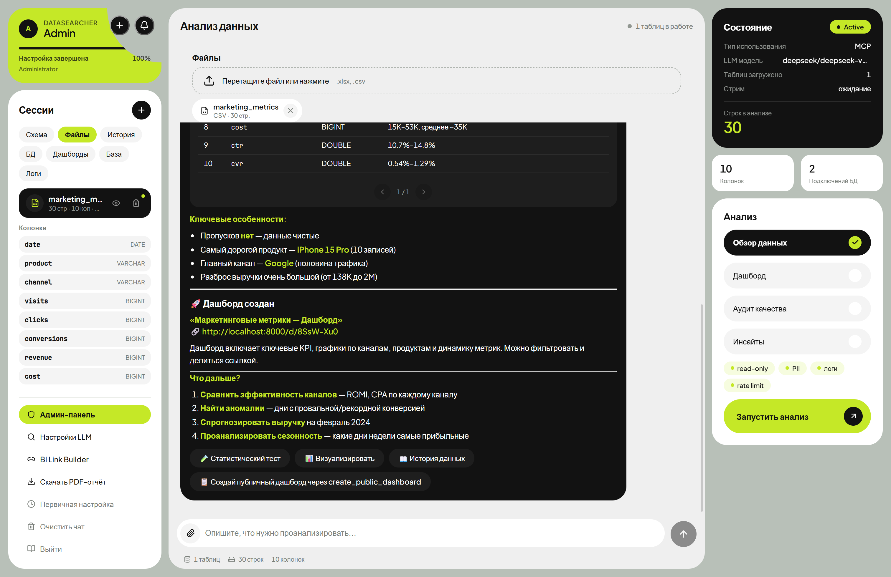

---

## Why

I analyze data every day. Excel is slow. Python has a barrier to entry.
BI systems are overkill for a quick "how many customers churned last quarter and why".

I wanted a tool that understands plain-language questions, writes SQL by itself,
builds charts, finds anomalies and forecasts trends. No setup.
No dashboards with 20 widgets. Just — upload a file or connect a database and ask.

DataSearcher is an attempt to make data analysis conversational.
Not "write SQL" — but "which factors drive churn the most".
Not "build a chart" — but "show me the sales trend with a 3-month forecast".

---

## How it works

```
┌─────────────────── Web Interface ───────────────────┐
│   React UI  ──SSE──▶  FastAPI + LLM  ──▶  DuckDB    │
│                        │                             │
│                        ├── 46 analysis tools         │
│                        ├── JWT auth + admin panel    │
│                        └── DB connections (push-down)│
└─────────────────────────────────────────────────────┘
┌─────────────────── MCP ─────────────────────────────┐
│   Claude / Cursor ──stdio/HTTP──▶  FastMCP server   │
│                        │                             │
│                        ├── the same 46 tools         │
│                        ├── connections.yaml          │
│                        └── Bearer auth (HTTP)        │
└─────────────────────────────────────────────────────┘
            PostgreSQL · MySQL · ClickHouse · SQLite · REST API
```

1. The user uploads .xlsx/.csv/.parquet or connects an existing database
2. Asks a question in plain language
3. The LLM picks the right tools, runs SQL (in DuckDB or pushed down to the source DB), builds charts
4. The result streams into the chat with interactive tables and charts
5. PII columns are masked automatically; every query is logged for audit

---

## Primary setup (Setup wizard)

On first launch the Web Interface opens a **primary setup wizard** —
a Bento screen with 4 steps:

| Step 1 "Type" — Interface or MCP | "Data" step — files and DBs |
|---|---|
| 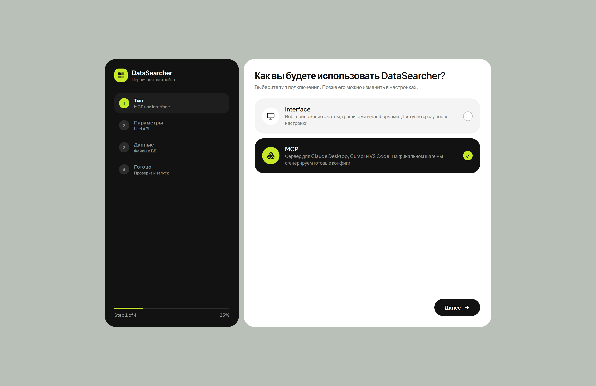 | 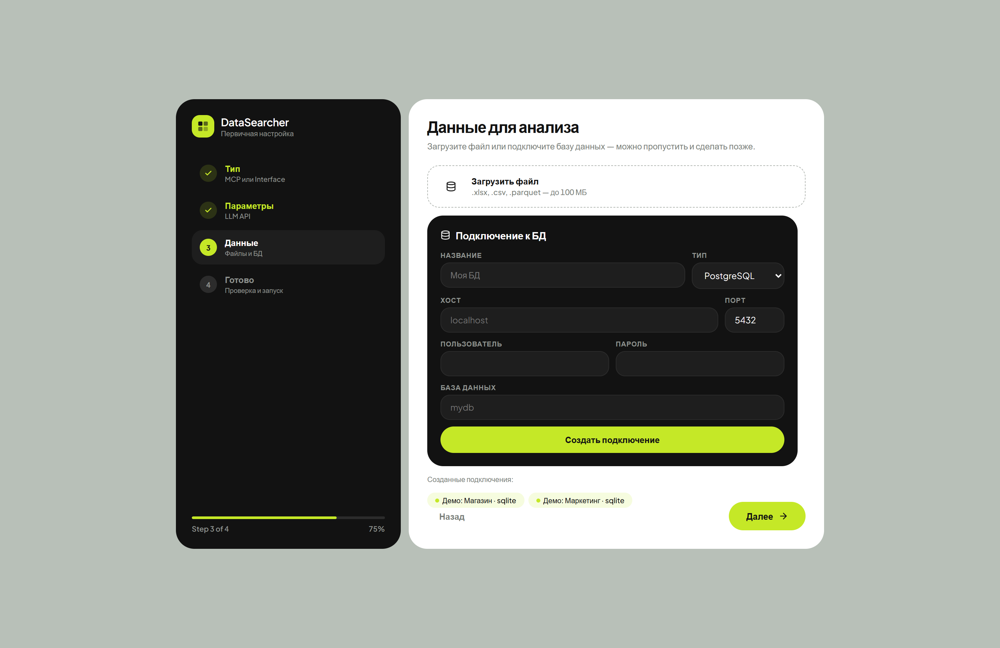 |

1. **Type** — MCP or Interface: large selectable widget cards
2. **Parameters** — LLM API (URL, model, key + connection test), default mode
3. **Data** — files (dropzone) or database connections (PostgreSQL/MySQL/ClickHouse/SQLite/API + auto/remote/dump/federated modes)
4. **Finish** — security toggles (read-only, PII, rate limit, logging), scope ("all users" / "just me"), Confirm

After choosing the **MCP** type the wizard generates ready-to-use configs from the
created connections: `connections.yaml`, JSON for Claude Desktop and Cursor, an HTTP
command — with copy and download buttons. Setup progress is shown on the profile
card (Step N of 4).

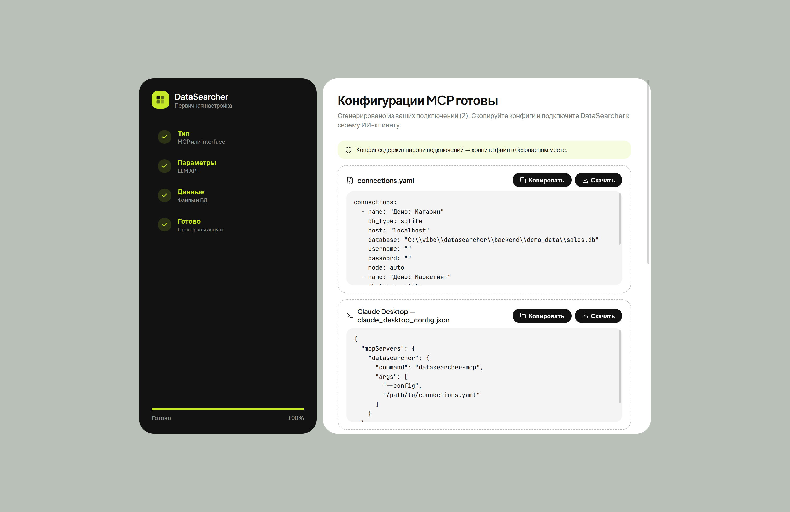

---

## 46 analysis tools

### SQL and connections

| # | Tool | Description |
|---|------|-------------|
| 1 | `sql_query` | SQL (DuckDB or push-down to source DB, read-only guard, PII masking, markdown/json/csv formats) |
| 2 | `query_explain` | SQL execution plan (EXPLAIN) |
| 3 | `get_schema` | Table structure + Knowledge Base metadata + PII marks |
| 4 | `attach_database` | Attach a new DB at runtime (auto/remote/dump/federated) |
| 5 | `refresh_schema` | Refresh the connection schema |
| 6 | `test_connection` | Check connection availability |
| 7 | `load_file` | Load CSV/Excel/Parquet |

### Data analytics

| # | Tool | Description |
|---|------|-------------|
| 8 | `profile_data` | Detailed per-column statistics |
| 9 | `smart_summary` | Smart description of the data structure |
| 10 | `data_quality_report` | Quality audit (gaps, duplicates) |
| 11 | `find_duplicates` | Duplicate search (exact and fuzzy) |
| 12 | `detect_anomalies` | Outliers (z-score, IQR) |
| 13 | `sample_data` | Quick data preview |
| 14 | `correlation_analysis` | Correlations (Pearson/Spearman) |
| 15 | `distribution_analysis` | Distribution shape |
| 16 | `cross_tab` | Cross-tabulation + Chi-square |
| 17 | `pivot_table` | Excel-style pivot table |
| 18 | `segment_data` | Segmentation (quintiles, RFM) |
| 19 | `compare_tables` | Compare two tables |
| 20 | `time_analysis` | Trends, seasonality, dynamics |
| 21 | `auto_insights` | Automatic top-5 insights |
| 22 | `detect_patterns` | Text patterns (email, tax IDs, phones) |

### ML and forecasts

| # | Tool | Description |
|---|------|-------------|
| 23 | `generate_sql` | SQL generation from a plain-language description |
| 24 | `visualize_data` | Charts (bar, line, pie, scatter, area, histogram) |
| 25 | `predict_trend` | Future trend forecast |
| 26 | `cluster_analysis` | Clustering (K-Means, DBSCAN) |
| 27 | `feature_importance` | Feature importance for a target variable |
| 28 | `statistical_test` | t-test, Mann-Whitney, KS, Chi-square |
| 29 | `classify_rows` | LLM-based row classification |
| 30 | `semantic_search` | Semantic search via LLM embeddings |

### Data management and BI

| # | Tool | Description |
|---|------|-------------|
| 31 | `transform_data` | Transformations (normalization, one-hot, dates) |
| 32 | `merge_tables` | JOIN (with automatic FK key detection) |
| 33 | `export_data` | Export to CSV |
| 34 | `export_xlsx` | Export to formatted XLSX |
| 35 | `build_dashboard` | 4-6 chart dashboard in the chat |
| 36 | `data_story` | Narrative with charts |
| 37 | `create_public_dashboard` | Standalone HTML dashboard by link |
| 38 | `build_bi_link` | URLs for Superset/Grafana/Datalens/Tableau/Power BI |

### Metadata and audit (enterprise)

| # | Tool | Description |
|---|------|-------------|
| 39 | `scan_pii` | Scan a table for PII |
| 40 | `update_metadata` | Update business descriptions in the Knowledge Base |
| 41 | `list_metrics` | List calculated metrics with formulas |
| 42 | `search_knowledge` | Search metadata and examples |
| 43 | `add_example` | Add a "NL→SQL" reference to the Example Store |
| 44 | `load_dbt` | Import metadata from a dbt manifest |
| 45 | `sync_datahub` | Sync with DataHub |
| 46 | `get_logs` | Query/error/audit logs |

---

## Interface (Soft Bento Neo-Brutalism)

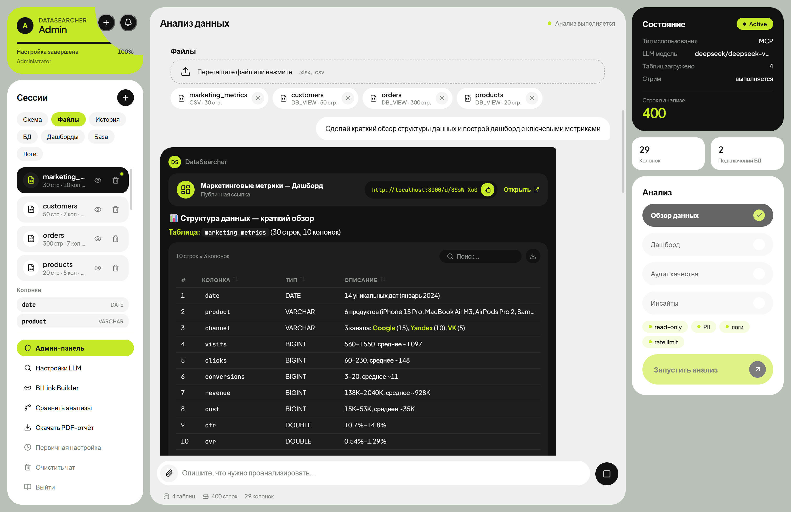

The UI follows a tactile Bento concept: zones are separated by dense color blocks
(sage gray, light gray, white, ink black, acid lime) with large corner radii —
no shadows and no thin borders.

- **3-column Bento Workspace** — navigation on the left, interactive stream in the center, live state on the right
- **Rich Generative UI** — AI messages contain interactive widgets: selection cards, parameter chips, file dropzones, progress bars
- **Profile card with progress** — Step N of 4 and the setup percentage
- **Live state inspector** — dark Draft/Active card, key-value table, lime summary metric
- **Bilingual UI** — English and Russian, switchable from the profile card, login screen or setup wizard; the LLM answers in the selected language
- **Interactive tables** — sorting, search, pagination, CSV export, NULL highlighting
- **Chart PNG export** — button on every chart, 2x pixel ratio
- **PDF reports** — title page, charts as PNG, Ctrl+Shift+P
- **Analysis templates** — quick-start action cards (Overview, Dashboard, Audit, Trends, Correlations, Story)
- **Auto profile + dashboard** — the first uploaded file triggers an analysis automatically
- **Notifications** — sound + Web Notification when the stream completes
- **Keyboard shortcuts** — Ctrl+K focus, Ctrl+Shift+P PDF
- **Query history** — session list on the left, click to re-run
- **Smart suggestions** — based on column types (date→trend, num→correlation, cat→cross-tab)
- **Analysis comparison** — split-view overlay
- **ER diagram** — visual schema of tables and columns
- **DB connections** — PostgreSQL, MySQL, ClickHouse, SQLite, REST API with modes (auto/remote/dump/federated)
- **Knowledge Base, metrics, Logs** — tabs in the left column
- **BI Link Builder** — generate URLs for Superset/Grafana/Datalens/Tableau/Power BI
- **Mobile adaptation** — single-column layout, welcome banner, bottom sheets

<details>
<summary><b>More screenshots</b></summary>

| Sign in | LLM parameters |
|---|---|
| 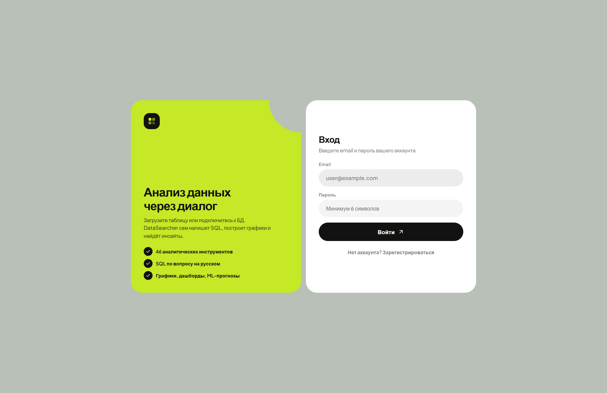 | 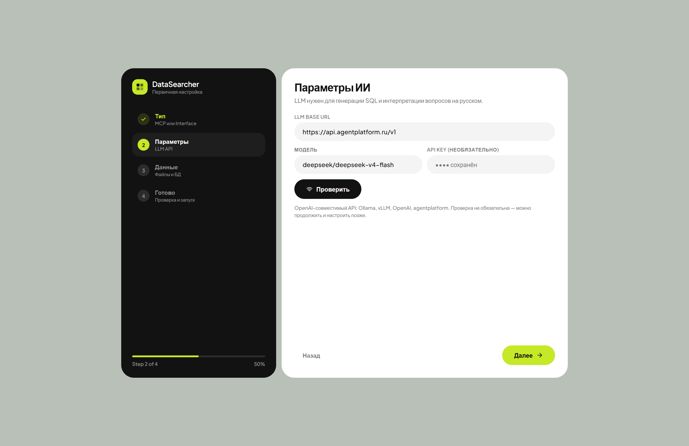 |

| Sales analysis (a table from a DB) | Public dashboard by link |
|---|---|
| 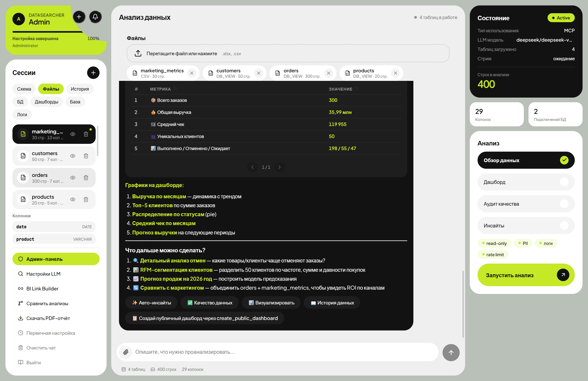 | 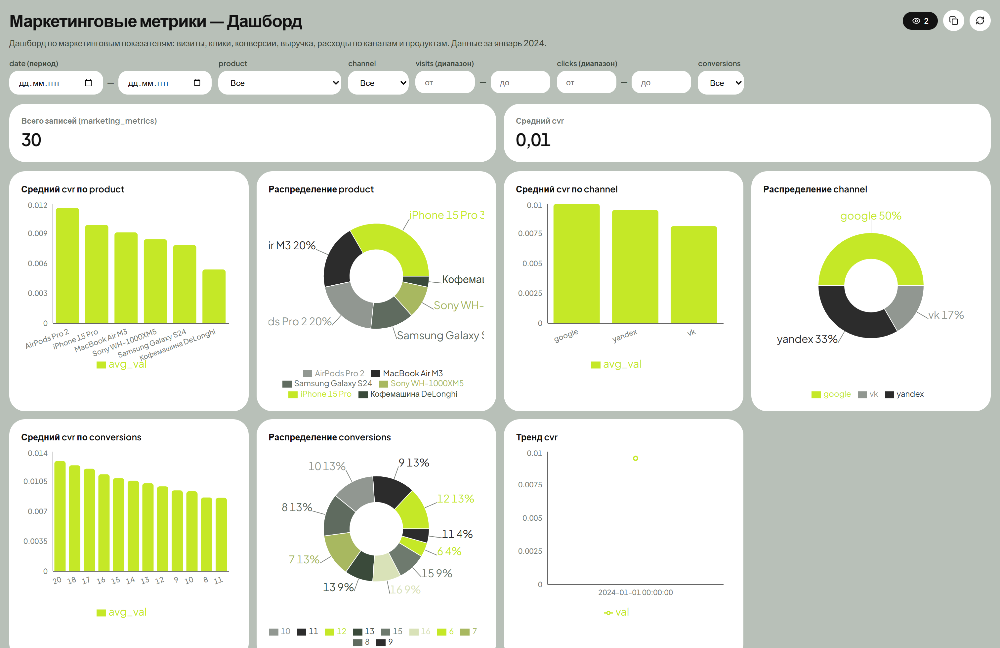 |

| Dashboard card in chat | Admin panel |
|---|---|
| 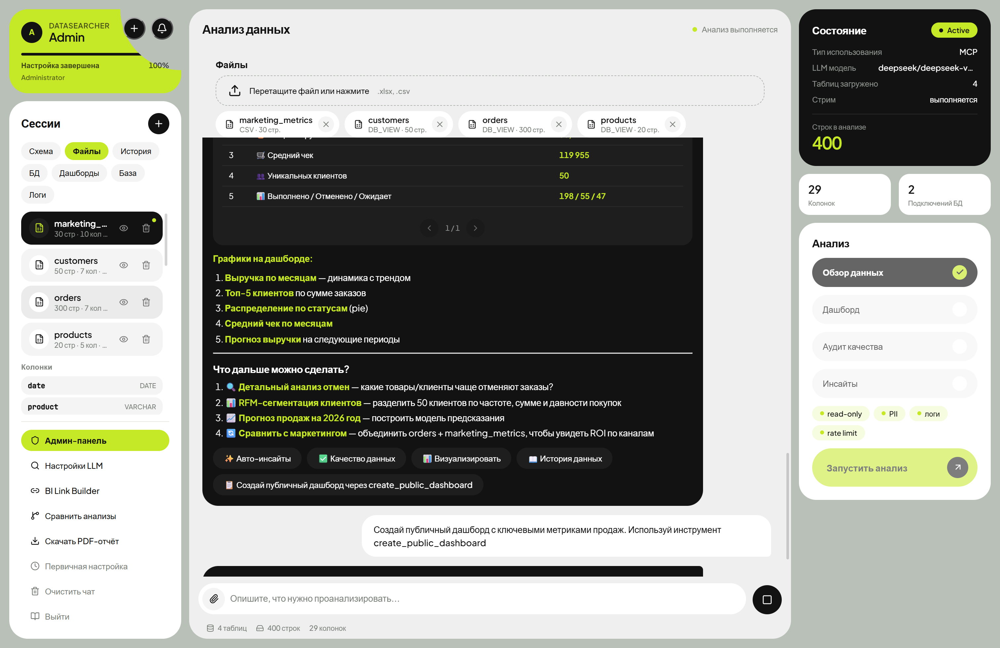 | 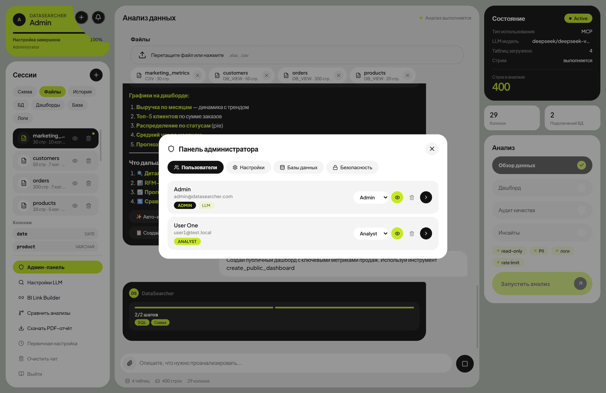 |

</details>

---

## Enterprise features

### Read-only guard
Every SQL query to a connected database is validated: INSERT/UPDATE/DELETE/DROP/TRUNCATE/ALTER are blocked. Only SELECT/WITH/EXPLAIN/SHOW/DESCRIBE are allowed. `READ_ONLY=false` disables the guard.

### PII auto-detection + masking
When a database is connected or a file uploaded, the server scans text columns and detects: emails, phone numbers, tax IDs, social security numbers, passports, bank cards, IPs. In SQL results PII is masked: `a***@company.com`, `+7(912)***-**-89`. Controlled by `PII_MASKING`.

### Knowledge Base (SQLite)
Business metadata in SQLite: table and column descriptions, owners, tags, calculated metrics. Filled from 4 sources (fallback chain): the DB schema (auto), dbt manifest (`load_dbt`), DataHub (`sync_datahub`), manual editing (`update_metadata`).

### Logging and audit
Every SQL query, ML call and error is logged to SQLite (append-only): `query_log`, `error_log`, `audit_log`. Browse them in the "Logs" tab or with the `get_logs` tool. Controlled by `LOG_ENABLED`.

### Rate limiting
Per-tool throttling: SQL — 60/min, ML — 10/min (configurable). `RATE_LIMIT_ENABLED=false` disables it.

### Schema ACL
Table filtering by business layer: `BLOCKED_TABLE_PATTERNS=raw_*,stg_*,tmp_*` — glob exclusion patterns.

### Connection modes

| Mode | How it works | When to use |
|------|--------------|-------------|
| `auto` (default) | SQL → source DB, ML → DuckDB (lazy) | Universal |
| `remote` | All SQL in the source DB, no DuckDB | Fast DB, no ML needed |
| `dump` | Tables are dumped into DuckDB | Files, small DBs |
| `federated` | The source DB is attached to DuckDB | Cross-DB JOINs |

### sqlglot SQL translation
Write DuckDB SQL — the server automatically translates it into the source DB dialect (PostgreSQL/MySQL/ClickHouse/SQLite). `AUTO_TRANSLATE=false` disables it.

### Semantic search + Example Store
`semantic_search` — search over text data via LLM embeddings. Example Store — a base of "NL query → SQL" pairs for few-shot learning of `generate_sql`.

### LLM modes (MCP only)

| `llm_mode` | How it works | When to use |
|-----------|--------------|-------------|
| `builtin` | LLM requests (`LLM_BASE_URL`/`LLM_MODEL`) | Ollama, vLLM, OpenAI |
| `sampling` | LLM via MCP sampling | Claude Desktop |
| `none` | No LLM at all | Without an LLM |

---

## Authorization and roles (Web Interface)

| Role | Capabilities |
|------|--------------|
| **admin** | Manage users, settings, DB connections, LLM parameters (global and per-user), primary setup for everyone |
| **analyst** | Upload files, run analyses, personal LLM settings (if allowed), personal DB connections |
| **viewer** | View data and analysis results |

### Admin panel

Three tabs:

**Users** — a list with badges (role, LLM, restrictions). Clicking a user opens a detail card with three sections:
- **Permissions** — individual toggles `can_use_custom_llm` / `can_use_db_connections`
- **LLM** — personal URL/Model/API Key settings (leave empty for global ones)
- **DB** — the user's connection list + "Add connection" button

**Settings** — global toggles:
- User registration (on/off)
- Custom LLM settings (on/off)
- Custom DB connections (on/off)
- Global LLM parameters (URL, Model, API Key)

**Databases** — connection CRUD, test, attach to the current session

---

## Quick start

### Prerequisites

- Python 3.12+
- Node.js 20+
- An LLM API (Ollama, vLLM, OpenAI-compatible) — for the chat

### Web Interface

```bash
# Backend
cd backend
cp .env.example .env
# Edit .env — set the LLM URL and generate JWT_SECRET
pip install -r requirements.txt
python -m uvicorn app.main:app --host 0.0.0.0 --port 8000

# Frontend
cd frontend
npm install
npm run dev
```

### First sign-in

An administrator is created by default:
- **Email:** `admin@datasearcher.com`
- **Password:** `admin`

Change the password after the first sign-in via the admin panel. The setup wizard opens right after the first sign-in.

### MCP mode

```bash
# Install (from the repo root)
cd mcp
pip install -e ".[all]"

# Configure connections
cp connections.example.yaml connections.yaml
# Edit connections.yaml

# Run stdio (Claude Desktop, Cursor, VS Code)
datasearcher-mcp --config /path/to/connections.yaml

# HTTP transport (remote access + Bearer auth)
datasearcher-mcp --transport http --host 0.0.0.0 --port 8000 --auth-token secret123
```

Connect to Claude Desktop:

```json
{
  "mcpServers": {
    "datasearcher": {
      "command": "datasearcher-mcp",
      "args": ["--config", "/path/to/connections.yaml"]
    }
  }
}
```

Cursor (`.cursor/mcp.json`):

```json
{"mcpServers": {"datasearcher": {"command": "datasearcher-mcp", "args": ["--config", "/path/to/connections.yaml"]}}}
```

<details>
<summary><b>Example connections.yaml</b></summary>

```yaml
connections:
  - name: my_db
    db_type: postgresql          # postgresql | mysql | clickhouse | sqlite | api
    host: localhost
    port: 5432
    database: mydb
    username: ${DB_USER}
    password: ${DB_PASSWORD}
    mode: auto                   # auto | remote | dump | federated
    allowed_schemas: [mart, analytics]
    blocked_tables: [raw_*, stg_*, tmp_*]

  # REST API works too:
  - name: crm_api
    db_type: api
    base_url: https://api.company.com/v1
    auth_header: "Authorization: Bearer ${CRM_TOKEN}"
    endpoints:
      - path: /customers
        table_name: customers
    mode: dump
```
</details>

> **Don't want to write connections.yaml by hand?** Launch the Web Interface,
> complete the setup wizard with the "MCP" type — the config is generated
> automatically from the connections you created in the UI.

### Demo without Docker (SQLite)

A full demo environment without a single container — two SQLite files with relational data:

```bash
python demo-data/make_demo_dbs.py
# → backend/demo_data/sales.db     (50 customers, 20 products, 300 orders, FK links)
# → backend/demo_data/marketing.db (30 rows of marketing analytics)
```

Then in the UI: **Setup wizard → "Data" step** or the **"DB" tab** → type `sqlite`,
the file path → "Attach". Cross-table queries work in the chat too: "find the top-5
customers by order total" — the AI performs the JOIN on `customer_id` by itself.

### Docker (demo environment with test databases)

```bash
# Start: backend + frontend + PostgreSQL + MySQL + ClickHouse with demo data
docker compose up -d --build

# Check status
docker compose ps

# Logs
docker compose logs -f backend

# Stop
docker compose down

# Full reset (delete data volumes)
docker compose down -v

# MCP server (optional)
docker compose --profile mcp up -d mcp    # → http://localhost:8100/mcp
```

After launch:
- **Frontend (UI):** http://localhost:3000
- **Backend API:** http://localhost:8000/api/health
- **MCP (profile mcp):** http://localhost:8100/mcp

#### Demo databases (preconfigured)

docker-compose spins up 3 databases with auto-initialized demo data:

| DB | Container | Port | Database | User | Password | Demo data |
|----|-----------|------|----------|------|----------|-----------|
| PostgreSQL | `postgres` | 5432 | `ecommerce` | `datasearcher` | `ds_demo_pass_2024` | 12 customers, 15 products, 25 orders, 50 items |
| MySQL | `mysql` | 3306 | `crm` | `datasearcher` | `ds_demo_pass_2024` | 8 managers, 30 deals, 40 interactions |
| ClickHouse | `clickhouse` | 8123 | `default` | `datasearcher` | `ds_demo_pass_2024` | 60 views, 30 clicks |

#### How to connect the demo databases via the UI

1. Open http://localhost:3000, sign in as `admin@datasearcher.com` / `admin`
2. Complete the setup wizard (or open the **DB** tab in the left column)
3. Create a connection:
   - **PostgreSQL:** host=`localhost`, port=`5432`, db=`ecommerce`, user=`datasearcher`, pass=`ds_demo_pass_2024`
   - **MySQL:** host=`localhost`, port=`3306`, db=`crm`, user=`datasearcher`, pass=`ds_demo_pass_2024`
   - **ClickHouse:** host=`localhost`, port=`8123`, db=`default`, user=`datasearcher`, pass=`ds_demo_pass_2024`
4. Choose the connection mode: `auto` (recommended — SQL in the source DB, ML in DuckDB)
5. Click "Attach" — the tables load

#### Demo CSV file

`demo-data/marketing_metrics.csv` — 30 rows of marketing analytics (channels, visits, clicks, conversions, ROI). Upload it via the UI (drag & drop in the setup wizard or the stream).

#### LLM for the chat

The chat needs an OpenAI-compatible LLM API:
```
LLM_BASE_URL=https://api.agentplatform.ru/v1
LLM_API_KEY=sk-...
LLM_MODEL=deepseek/deepseek-v4-flash
```

Or point to your own API (Ollama, vLLM, OpenAI) in `.env`. For Ollama:
```bash
ollama pull qwen2.5:14b
ollama serve
# .env: LLM_BASE_URL=http://host.docker.internal:11434/v1
```

---

## Environment variables

### Base (Web Interface)

| Variable | Default | Description |
|----------|---------|-------------|
| `LLM_BASE_URL` | `http://localhost:11434/v1` | LLM API URL (OpenAI-compatible) |
| `LLM_API_KEY` | `` | LLM API key |
| `LLM_MODEL` | `qwen2.5:14b` | LLM model |
| `JWT_SECRET` | *auto-generated* | JWT secret (MUST be set in prod!) |
| `ENCRYPTION_KEY` | `` | Fernet key for encrypting connection strings |
| `ADMIN_EMAIL` | `admin@datasearcher.com` | Default administrator email |
| `ADMIN_PASSWORD` | `admin` | Default administrator password |
| `UPLOAD_DIR` | `./uploads` | Upload directory |
| `DUCKDB_MEMORY_LIMIT` | `2GB` | DuckDB memory limit |

### Enterprise (Web Interface)

| Variable | Default | Description |
|----------|---------|-------------|
| `DEFAULT_MODE` | `auto` | Connection mode: auto/remote/dump/federated |
| `QUERY_TIMEOUT` | `60` | Remote SQL timeout (sec), 0 = no limit |
| `AUTO_TRANSLATE` | `true` | Translate DuckDB SQL → source DB dialect (sqlglot) |
| `DUCKDB_EXTENSIONS` | `postgres_scanner,...` | DuckDB extensions for federated mode |
| `READ_ONLY` | `true` | Read-only guard (blocks DML/DDL) |
| `BLOCKED_TABLE_PATTERNS` | `raw_*,stg_*,...` | Blocked table patterns (glob) |
| `PII_MASKING` | `true` | Automatic PII masking |
| `PII_SCAN_ROWS` | `10` | Rows for the PII scan |
| `RATE_LIMIT_ENABLED` | `true` | Rate limiting |
| `RATE_LIMIT_SQL` | `60` | SQL requests per minute |
| `RATE_LIMIT_ML` | `10` | ML requests per minute |
| `LOG_ENABLED` | `true` | Query/error/audit logging |
| `LOG_DB_PATH` | `` | SQLite log file (empty = `./datasearcher_logs.db`) |
| `KB_DB_PATH` | `` | SQLite Knowledge Base file (empty = `./datasearcher_kb.db`) |
| `DBT_MANIFEST_PATH` | `` | Path to dbt manifest.json |
| `DATAHUB_URL` | `` | DataHub URL for metadata sync |
| `DATAHUB_TOKEN` | `` | DataHub token |
| `EXAMPLE_STORE_ENABLED` | `true` | Example Store (few-shot NL→SQL) |
| `SEMANTIC_SEARCH_MAX_ROWS` | `10000` | Row limit for semantic_search |
| `EMBEDDINGS_DIR` | `` | Embeddings cache directory |

### MCP (prefix `DATASEARCHER_MCP_`)

| Variable | Default | Description |
|----------|---------|-------------|
| `DATASEARCHER_MCP_CONNECTIONS_FILE` | `connections.yaml` | Connections file |
| `DATASEARCHER_MCP_READ_ONLY` | `true` | Read-only guard (blocks DML/DDL) |
| `DATASEARCHER_MCP_PII_MASKING` | `true` | Automatic PII masking |
| `DATASEARCHER_MCP_LOG_ENABLED` | `true` | Query/error logging |
| `DATASEARCHER_MCP_RATE_LIMIT_ENABLED` | `true` | Rate limiting |
| `DATASEARCHER_MCP_RATE_LIMIT_SQL` | `60` | SQL requests per minute |
| `DATASEARCHER_MCP_RATE_LIMIT_ML` | `10` | ML requests per minute |
| `DATASEARCHER_MCP_QUERY_TIMEOUT` | `60` | Remote SQL timeout (sec) |
| `DATASEARCHER_MCP_AUTO_TRANSLATE` | `true` | SQL dialect translation |
| `DATASEARCHER_MCP_AUTH_TOKEN` | `` | Bearer token for HTTP auth |
| `DATASEARCHER_MCP_DUCKDB_ENABLED` | `false` | DuckDB lazy |
| `DATASEARCHER_MCP_DEFAULT_MODE` | `auto` | Default mode |
| `DATASEARCHER_MCP_EXAMPLE_STORE_ENABLED` | `true` | Example Store (few-shot) |

> **Security:** in production you MUST set `JWT_SECRET` and `ENCRYPTION_KEY`.
> Generate: `python -c "import secrets; print(secrets.token_hex(32))"` for JWT_SECRET
> and `python -c "from cryptography.fernet import Fernet; print(Fernet.generate_key().decode())"` for ENCRYPTION_KEY.

---

## Architecture

```
├── backend/                  # Web Interface: FastAPI
│   └── app/
│       ├── main.py           # FastAPI, lifespan, routers
│       ├── config.py         # pydantic-settings (base + enterprise)
│       ├── session.py        # SessionManager, DuckDB connections
│       ├── models/           # Pydantic + SQLAlchemy (User, AppSettings, DBConnection)
│       ├── routers/          # auth, admin, chat, files, connections, settings,
│       │                     # knowledge, logs, metadata, dashboards, setup
│       ├── i18n/ (via chat)  # lang hint for LLM responses (ru/en)
│       └── services/         # llm_service, engine, sql_guard, pii_detector,
│                             # knowledge_base, connectors/, tools/ (46 tools)
│
├── frontend/                 # Web Interface: React 19 (Bento UI)
│   └── src/
│       ├── api/client.ts     # API client (auth, admin, setup, connections, chat, KB, logs)
│       ├── i18n/             # EN/RU dictionaries + language store (auto-detect, localStorage)
│       ├── hooks/            # useAuth, useChat, useFiles, useNotification, ...
│       └── components/
│           ├── Bento/        # AppShell, ProfileCard, LeftColumn, RightColumn,
│           │                 # SummaryCard, InfoPills, ActionCard, LangSwitch
│           ├── Setup/        # SetupWizard: Type → Parameters → Data → Finish
│           ├── Chat/         # AI widgets, tables, charts, templates
│           ├── Layout/       # KnowledgeTab, LogsTab, SchemaDiagram, modals
│           ├── Admin/        # AdminPanel (Users / Settings / Connections)
│           └── Pages/        # LoginPage, RegisterPage, DashboardPage
│
├── mcp/                      # MCP server (shared tool core)
│   ├── pyproject.toml        # datasearcher-mcp package, datasearcher-mcp entrypoint
│   ├── connections.example.yaml
│   ├── Dockerfile
│   └── src/datasearcher_mcp/
│       ├── server.py         # FastMCP: 46 tools + 5 resources + 2 prompts
│       ├── __main__.py       # CLI: --transport, --config, --auth-token
│       ├── config.py         # 30+ parameters (pydantic-settings)
│       ├── engine.py         # remote/dump/auto/federated, ACL, KB, PII
│       ├── connectors/       # PostgreSQL, MySQL, ClickHouse, SQLite, REST API
│       ├── tools/             # analysis tools
│       └── render/            # matplotlib PNG + chart thumbnails
│
├── demo-data/                # demo CSV + SQL init for demo DBs + make_demo_dbs.py
└── docker-compose.yml        # web stack + profile mcp
```

---

## Technologies

| Layer | Technology |
|-------|------------|
| Frontend | React 19, TypeScript, Vite, Recharts, @tanstack/react-table, Plus Jakarta Sans |
| Backend | FastAPI, DuckDB, SQLAlchemy, JWT (PyJWT), bcrypt (passlib) |
| MCP | mcp[cli] 1.28 (FastMCP, stdio/SSE/HTTP) |
| ML/Analysis | scikit-learn, scipy, numpy |
| DB Drivers | psycopg2 (PostgreSQL), pymysql (MySQL), clickhouse-connect, aiosqlite |
| SQL translation | sqlglot (DuckDB → source DB dialect) |
| KB / logs | SQLite (embedded, zero-dependency) |
| Embeddings | OpenAI-compatible /v1/embeddings |
| Files | CSV/Parquet (DuckDB), Excel (pandas/openpyxl) |
| PDF | fpdf2 with embedded PNG charts |
| Export | html-to-image (chart PNG), openpyxl (XLSX) |
| i18n | EN/RU dictionaries, browser auto-detect, language switch in UI, LLM response language |

---

## Tests

### Backend (pytest, 354+ tests)

```bash
cd backend
python -m pytest tests/ -v
```

| File | Coverage |
|------|----------|
| `test_sql_guard.py` | read-only guard: allowed/blocked statements, CTE injections |
| `test_pii_detector.py` | detect by name/values, mask for 7 PII types, scan_table |
| `test_error_handler.py` | all error patterns, markdown format, truncate, suggestions |
| `test_rate_limiter.py` | SQL/ML categories, sliding window, per-user isolation |
| `test_bi_linker.py` | all 5 BI tools + edge cases, params, time_range |
| `test_dbt_loader.py` | manifest.json parsing, KB enrichment, semantic_models.yml |
| `test_connectors.py` | registry, SQLite (CRUD, FK, attach_syntax), ApiConnector |
| `test_kb_logs_examples.py` | KB CRUD, search, LoggingDB, ExampleStore |
| `test_engine.py` | load_csv, translate_sql, ensure_table_in_duckdb, FK heuristics |
| `test_tools.py` + `test_tools_extra.py` | 46 tools, sql_query (guard+PII+formats), export, profile |
| `test_api.py` | auth, knowledge CRUD, logs, metadata, connections/modes, admin |
| `test_setup.py` | Setup wizard API: type, parameters, MCP config generation |

### Frontend (vitest)

```bash
cd frontend
npm test
```

| File | Coverage |
|------|----------|
| `SetupWizard.test.tsx` | 4 steps, type selection, MCP config generation |
| `i18n.test.tsx` | EN/RU switching, localized chips and profile card |
| `KnowledgeTab.test.tsx` | tables/metrics loading, search, dbt/datahub, certified badge |
| `LogsTab.test.tsx` | 3 tabs (query/error/audit), switching, empty states |
| `BILinkModal.test.tsx` | 5 BI tools, URL/JSON validation, time-range, copy |
| `LeftColumn.test.tsx` | files, history, tab switching |
| `AdminPanel.test.tsx` | 4 tabs, enterprise settings, error handling |

---

## License

MIT

