> **Русский** | [English](README.md)

# DataSearcher


[](../../actions/workflows/backend.yml)
[](../../actions/workflows/frontend.yml)
[](../../actions/workflows/mcp.yml)

> Загрузи таблицу или подключись к БД. Задай вопрос. Получи ответ с графиками.
> 46 аналитических инструментов, ML-прогнозы, дашборды, enterprise-безопасность.

**DataSearcher — один продукт с двумя типами использования:**

| Тип | Что это | Для кого |
|-----|---------|----------|
| **Web Interface** | Чат-дашборд: React UI + FastAPI, диалог на русском, графики, дашборды, админ-панель | Аналитики, бизнес-пользователи |
| **MCP** | MCP-сервер (Claude Desktop, Cursor, VS Code): те же 46 инструментов прямо в твоём ИИ-клиенте | Пользователи Claude/Cursor |

Оба типа делят одно ядро: 46 инструментов, read-only guard, PII-маскирование,
Knowledge Base, sqlglot-трансляцию SQL и коннекторы (PostgreSQL, MySQL, ClickHouse, SQLite, REST API).

Интерфейс и ответы ИИ двуязычны — **русский и English** — язык переключается прямо в интерфейсе.

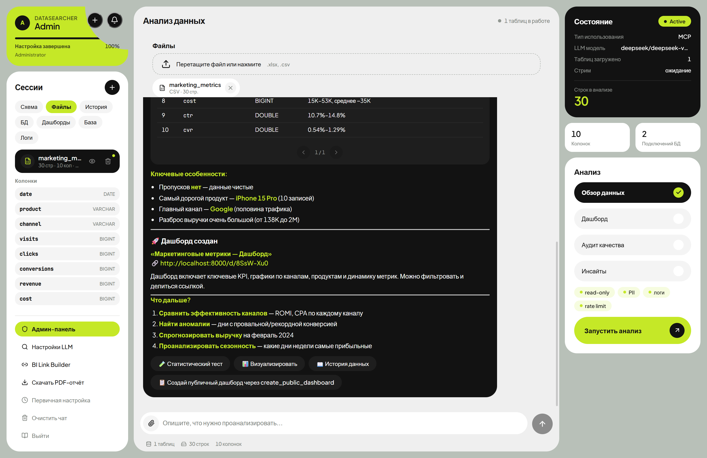

---

## Зачем

Я анализирую данные каждый день. Excel — медленно. Python — порог входа.
BI-системы — оверкилл для быстрого вопроса «сколько клиентов ушли в прошлом
квартале и почему».

Хотелось инструмента, который понимает вопросы на русском, сам пишет SQL,
строит графики, находит аномалии и прогнозирует тренды. Без настройки.
Без дашбордов из 20 виджетов. Просто — загрузил файл или подключился к БД и спросил.

DataSearcher — это попытка сделать аналитику данных разговорной.
Не «напиши SQL», а «какие факторы сильнее всего влияют на отток».
Не «построй график», а «покажи тренд продаж с прогнозом на 3 месяца».

---

## Как это работает

```
┌─────────────────── Web Interface ───────────────────┐
│   React UI  ──SSE──▶  FastAPI + LLM  ──▶  DuckDB    │
│                        │                             │
│                        ├── 46 analysis tools         │
│                        ├── JWT auth + admin panel    │
│                        └── DB connections (push-down)│
└─────────────────────────────────────────────────────┘
┌─────────────────── MCP ─────────────────────────────┐
│   Claude / Cursor ──stdio/HTTP──▶  FastMCP server   │
│                        │                             │
│                        ├── те же 46 tools            │
│                        ├── connections.yaml          │
│                        └── Bearer auth (HTTP)        │
└─────────────────────────────────────────────────────┘
            PostgreSQL · MySQL · ClickHouse · SQLite · REST API
```

1. Пользователь загружает .xlsx/.csv/.parquet или подключается к существующей БД
2. Задаёт вопрос на русском
3. LLM выбирает нужные инструменты, выполняет SQL (в DuckDB или push-down в source DB), строит графики
4. Результат стримится в чат с интерактивными таблицами и чартами
5. PII-колонки автоматически маскируются, все запросы логируются для аудита

---

## Первичная настройка (Setup-визард)

При первом запуске Web Interface открывается **визард первичной настройки** —
Bento-экран из 4 шагов:

| Шаг 1 «Тип» — Interface или MCP | Шаг «Данные» — файлы и БД |
|---|---|
| 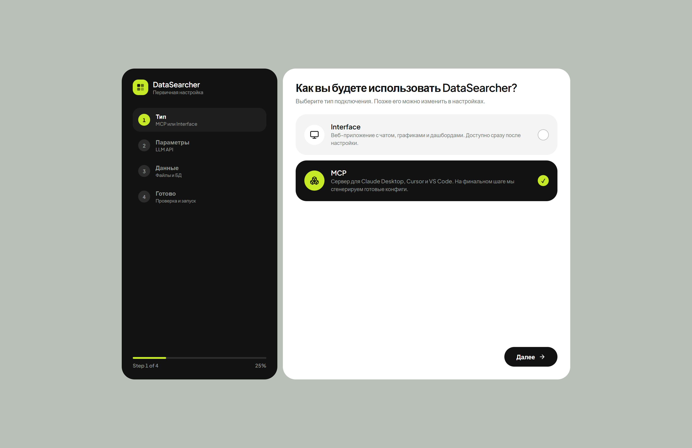 | 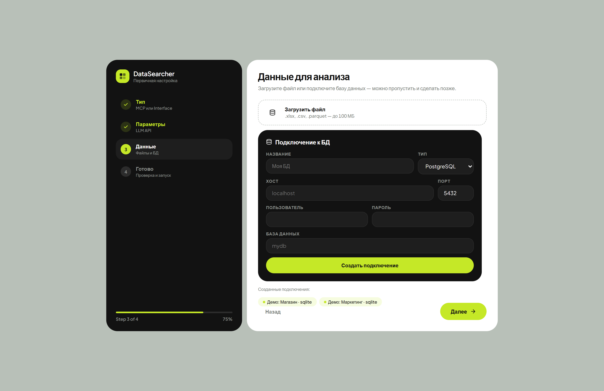 |

1. **Тип** — MCP или Interface: большая карточка-виджет для выбора
2. **Параметры** — LLM API (URL, model, key + проверка подключения), режим по умолчанию
3. **Данные** — файлы (dropzone) или подключения к БД (PostgreSQL/MySQL/ClickHouse/SQLite/API + режим auto/remote/dump/federated)
4. **Готово** — security-тумблеры (read-only, PII, rate limit, логи), scope («для всех» / «только для меня»), Confirm

После выбора типа **MCP** визард генерирует готовые конфиги из созданных
подключений: `connections.yaml`, JSON для Claude Desktop и Cursor, HTTP-команду —
с кнопками копирования и скачивания. Прогресс настройки отображается в карточке
профиля (Step N of 4).

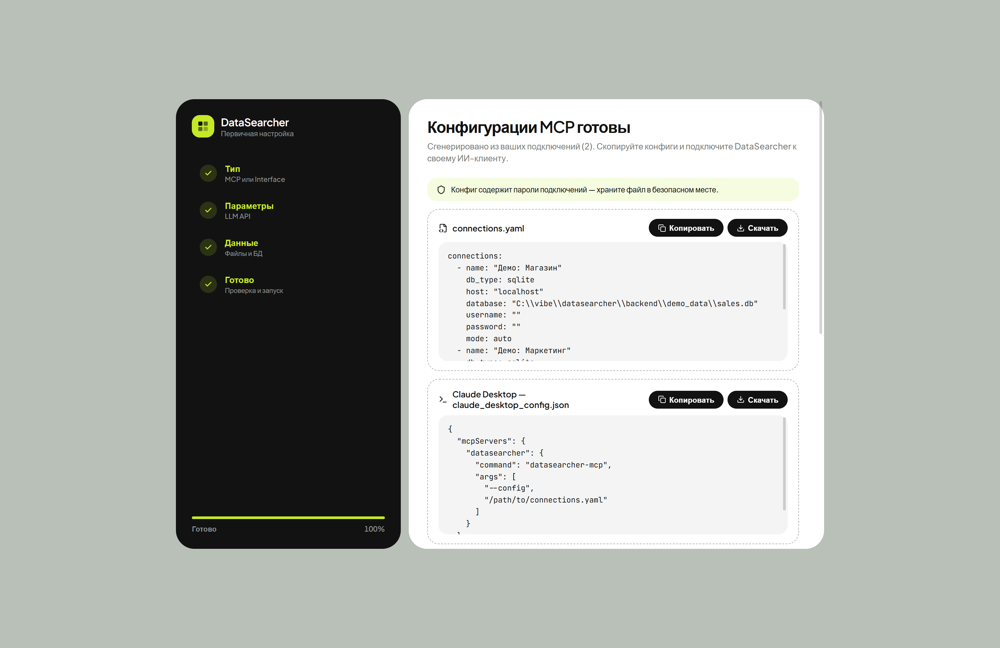

---

## 46 инструментов анализа

### SQL и подключения

| # | Инструмент | Описание |
|---|-----------|----------|
| 1 | `sql_query` | SQL (DuckDB или push-down в source DB, read-only guard, PII-маскирование, форматы markdown/json/csv) |
| 2 | `query_explain` | План выполнения SQL (EXPLAIN) |
| 3 | `get_schema` | Структура таблицы + метаданные из Knowledge Base + PII-метки |
| 4 | `attach_database` | Подключить новую БД в рантайме (auto/remote/dump/federated) |
| 5 | `refresh_schema` | Обновить схему подключений |
| 6 | `test_connection` | Проверить доступность подключения |
| 7 | `load_file` | Загрузить CSV/Excel/Parquet |

### Аналитика данных

| # | Инструмент | Описание |
|---|-----------|----------|
| 8 | `profile_data` | Детальная статистика по колонкам |
| 9 | `smart_summary` | Умное описание структуры данных |
| 10 | `data_quality_report` | Аудит качества (пропуски, дубликаты) |
| 11 | `find_duplicates` | Поиск дубликатов (точных и fuzzy) |
| 12 | `detect_anomalies` | Выбросы (z-score, IQR) |
| 13 | `sample_data` | Быстрый просмотр данных |
| 14 | `correlation_analysis` | Корреляции (Пирсон/Спирмен) |
| 15 | `distribution_analysis` | Форма распределения |
| 16 | `cross_tab` | Кросс-табуляция + Хи-квадрат |
| 17 | `pivot_table` | Сводная таблица в стиле Excel |
| 18 | `segment_data` | Сегментация (квинтили, RFM) |
| 19 | `compare_tables` | Сравнение двух таблиц |
| 20 | `time_analysis` | Тренды, сезонность, динамика |
| 21 | `auto_insights` | Авто-поиск топ-5 инсайтов |
| 22 | `detect_patterns` | Паттерны в тексте (email, ИНН, телефон) |

### ML и прогнозы

| # | Инструмент | Описание |
|---|-----------|----------|
| 23 | `generate_sql` | Генерация SQL из описания на русском |
| 24 | `visualize_data` | Графики (bar, line, pie, scatter, area, histogram) |
| 25 | `predict_trend` | Прогноз тренда на будущее |
| 26 | `cluster_analysis` | Кластеризация (K-Means, DBSCAN) |
| 27 | `feature_importance` | Важность факторов для целевой переменной |
| 28 | `statistical_test` | t-тест, Mann-Whitney, KS, Хи-квадрат |
| 29 | `classify_rows` | Классификация строк через LLM |
| 30 | `semantic_search` | Семантический поиск через LLM embeddings |

### Управление данными и BI

| # | Инструмент | Описание |
|---|-----------|----------|
| 31 | `transform_data` | Преобразования (нормализация, one-hot, даты) |
| 32 | `merge_tables` | JOIN (с авто-определением ключей по FK) |
| 33 | `export_data` | Экспорт в CSV |
| 34 | `export_xlsx` | Экспорт в XLSX с форматированием |
| 35 | `build_dashboard` | Дашборд из 4-6 графиков в чате |
| 36 | `data_story` | Нарратив с графиками |
| 37 | `create_public_dashboard` | Standalone HTML-дашборд по ссылке |
| 38 | `build_bi_link` | URL для Superset/Grafana/Datalens/Tableau/Power BI |

### Метаданные и аудит (enterprise)

| # | Инструмент | Описание |
|---|-----------|----------|
| 39 | `scan_pii` | Скан PII в таблице |
| 40 | `update_metadata` | Обновить метаописание в Knowledge Base |
| 41 | `list_metrics` | Список расчётных метрик с формулами |
| 42 | `search_knowledge` | Поиск по метаданным и примерам |
| 43 | `add_example` | Добавить эталон «NL→SQL» в Example Store |
| 44 | `load_dbt` | Импорт метаданных из dbt manifest |
| 45 | `sync_datahub` | Синхронизация с DataHub |
| 46 | `get_logs` | Логи запросов/ошибок/аудита |

---

## Интерфейс (Soft Bento Neo-Brutalism)

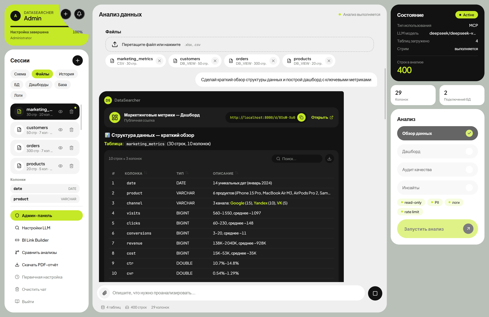

UI построен по концепции тактильного Bento-интерфейса: зоны разделены плотными
цветовыми блоками (шалфейно-серый, светло-серый, белый, угольно-чёрный,
кислотно-лаймовый) с большими скруглениями — без теней и тонких рамок.

- **3-колоночный Bento Workspace** — навигация слева, интерактивный поток в центре, живое состояние справа
- **Rich Generative UI** — сообщения ИИ содержат интерактивные виджеты: карточки выбора, чипсы параметров, дропзоны файлов, прогресс-бары
- **Карточка профиля с прогрессом** — Steps N of 4 и процент настройки
- **Сводка состояния (Inspector)** — тёмная карточка Draft/Active, key-value таблица, лаймовая итоговая метрика
- **Интерактивные таблицы** — сортировка, поиск, пагинация, экспорт CSV, подсветка NULL
- **Экспорт графиков PNG** — кнопка на каждом чарте, 2x pixel ratio
- **PDF-отчёты** — титульная страница, графики как PNG, Ctrl+Shift+P
- **Шаблоны анализов** — карточки быстрых действий для старта (Обзор, Дашборд, Аудит, Тренды, Корреляции, Стори)
- **Авто-профиль + дашборд** — при загрузке первого файла автоматически запускается анализ
- **Уведомления** — звук + Web Notification при завершении стрима
- **Горячие клавиши** — Ctrl+K фокус, Ctrl+Shift+P PDF
- **История запросов** — список сессий слева, клик = повтор
- **Умные подсказки** — на основе типов колонок (date→тренд, num→корреляция, cat→кросс-таб)
- **Сравнение анализов** — split-view оверлей
- **ER-схема** — визуальная схема таблиц и колонок
- **Подключения к БД** — PostgreSQL, MySQL, ClickHouse, SQLite, REST API с режимами (auto/remote/dump/federated)
- **База знаний, метрики, Логи** — вкладки в левой колонке
- **BI Link Builder** — генерация URL в Superset/Grafana/Datalens/Tableau/Power BI
- **Мобильная адаптация** — single-column layout, welcome-баннер, bottom sheets

<details>
<summary><b>Больше скриншотов</b></summary>

| Вход | Параметры LLM |
|---|---|
| 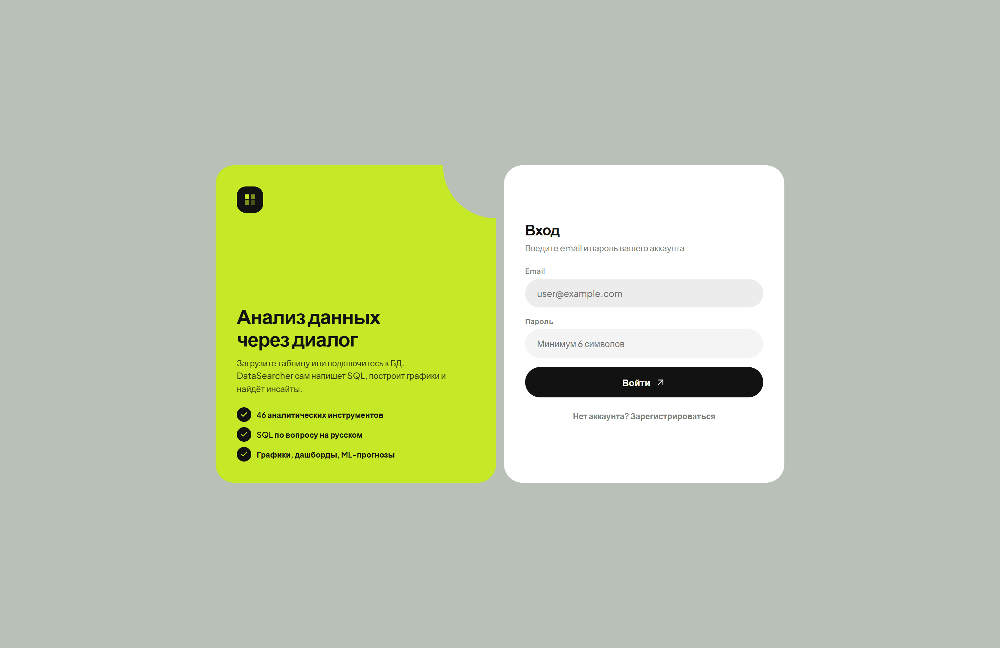 | 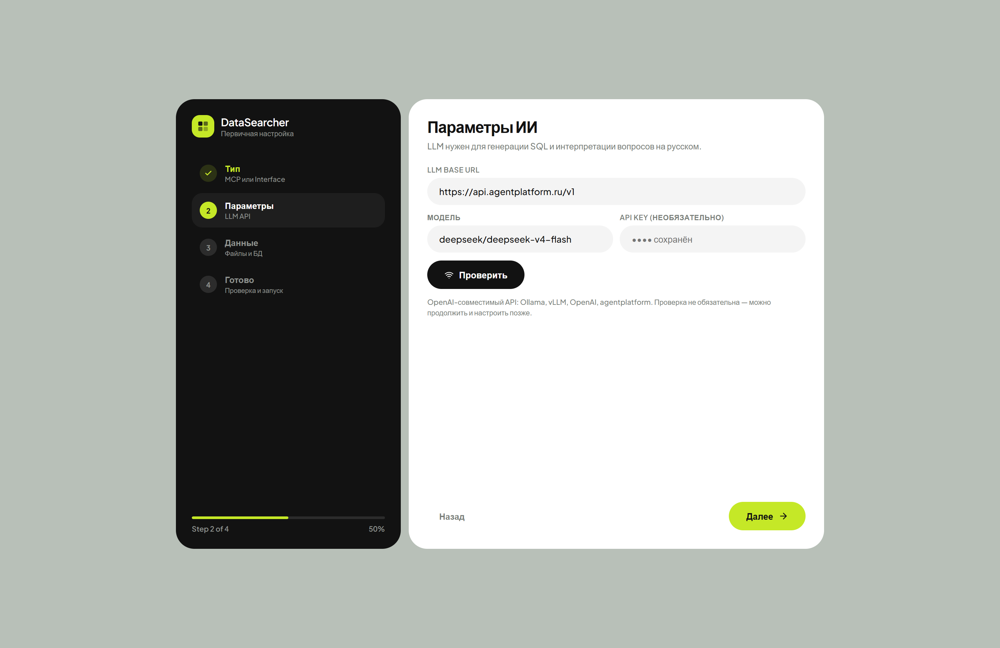 |

| Анализ продаж (таблица из БД) | Публичный дашборд по ссылке |
|---|---|
| 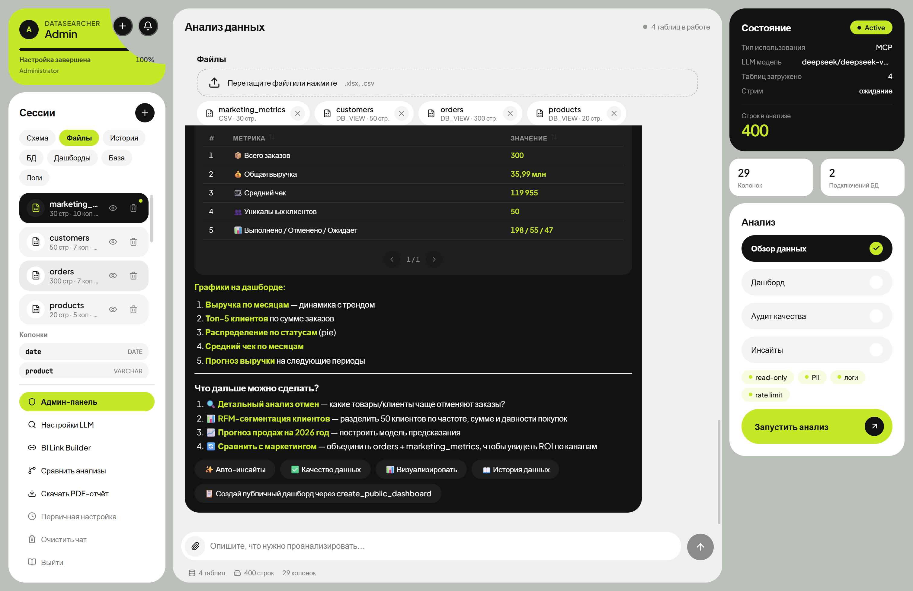 | 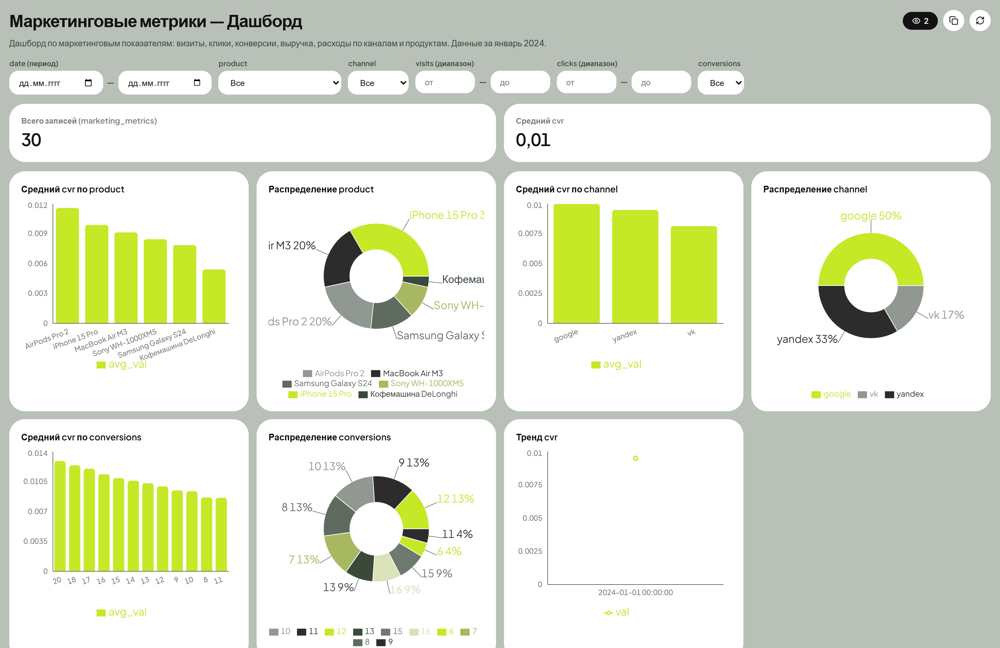 |

| Карточка дашборда в чате | Админ-панель |
|---|---|
| 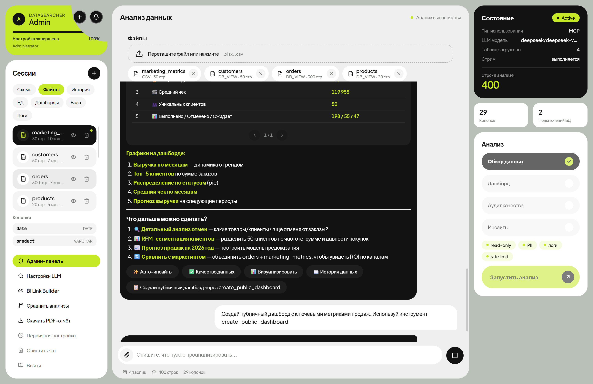 | 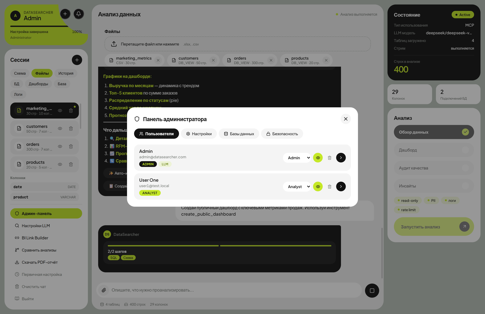 |

</details>

---

## Enterprise-фичи

### Read-only guard
Все SQL-запросы к подключённым БД проверяются: INSERT/UPDATE/DELETE/DROP/TRUNCATE/ALTER — заблокированы. Разрешены только SELECT/WITH/EXPLAIN/SHOW/DESCRIBE. `READ_ONLY=false` отключает guard.

### PII auto-detection + masking
При подключении БД и загрузке файлов сервер сканирует текстовые колонки и определяет: email, телефон (РФ), ИНН, СНИЛС, паспорт, банковскую карту, IP. В результатах SQL PII маскируется: `a***@company.com`, `+7(912)***-**-89`. Управляется через `PII_MASKING`.

### Knowledge Base (SQLite)
Бизнес-метаданные в SQLite: описания таблиц, колонок, владельцы, теги, расчётные метрики. Наполняется из 4 источников (fallback-цепочка): схема БД (авто), dbt manifest (`load_dbt`), DataHub (`sync_datahub`), ручная правка (`update_metadata`).

### Логирование и аудит
Каждый SQL-запрос, ML-вызов, ошибка логируются в SQLite (append-only): `query_log`, `error_log`, `audit_log`. Просмотр через вкладку «Логи» или инструмент `get_logs`. Управляется через `LOG_ENABLED`.

### Rate limiting
Per-tool throttling: SQL — 60/мин, ML — 10/мин (настраивается). `RATE_LIMIT_ENABLED=false` отключает.

### Schema ACL
Фильтрация таблиц по бизнес-слою: `BLOCKED_TABLE_PATTERNS=raw_*,stg_*,tmp_*` — glob-паттерны исключений. В MCP: `allowed_schemas` / `blocked_tables` в connections.yaml.

### Режимы подключений

| Режим | Как работает | Когда использовать |
|-------|-------------|-------------------|
| `auto` (по умолч.) | SQL → source DB, ML → DuckDB (лениво) | Универсальный |
| `remote` | Всё SQL в source DB, без DuckDB | БД быстрая, ML не нужен |
| `dump` | Таблицы выгружаются в DuckDB | Файлы, маленькие БД |
| `federated` | Source DB прицепляется к DuckDB | Кросс-БД JOIN |

### sqlglot трансляция SQL
Пишите на DuckDB SQL — сервер автоматически транслирует в диалект source DB (PostgreSQL/MySQL/ClickHouse/SQLite). `AUTO_TRANSLATE=false` отключает.

### Semantic search + Example Store
`semantic_search` — поиск по текстовым данным через LLM embeddings. Example Store — база пар «NL-запрос → SQL» для few-shot обучения `generate_sql`.

### LLM режимы (только MCP)

| `llm_mode` | Как работает | Когда использовать |
|-----------|-------------|-------------------|
| `builtin` | LLM-запросы (`LLM_BASE_URL`/`LLM_MODEL`) | Ollama, vLLM, OpenAI |
| `sampling` | LLM через MCP sampling | Claude Desktop |
| `none` | Классификация без LLM | Без LLM |

---

## Авторизация и роли (Web Interface)

| Роль | Возможности |
|------|------------|
| **admin** | Управление пользователями, настройками, подключениями к БД, LLM-параметрами (глобальными и индивидуальными), первичная настройка для всех |
| **analyst** | Загрузка файлов, анализ, свои LLM-настройки (если разрешено), свои подключения к БД |
| **viewer** | Просмотр данных и результатов анализа |

### Admin-панель

Три вкладки:

**Пользователи** — список с бейджами (роль, LLM, ограничения). Клик по пользователю открывает детальную карточку с тремя секциями:
- **Права** — индивидуальные переключатели `can_use_custom_llm` / `can_use_db_connections`
- **LLM** — индивидуальные настройки URL/Model/API Key (оставьте пустыми для глобальных)
- **БД** — список подключений пользователя + кнопка «Добавить подключение»

**Настройки** — глобальные переключатели:
- Регистрация пользователей (вкл/выкл)
- Пользовательские LLM-настройки (вкл/выкл)
- Пользовательские подключения к БД (вкл/выкл)
- Глобальные LLM-параметры (URL, Model, API Key)

**Базы данных** — CRUD подключений, тест, подключение к текущей сессии

---

## Быстрый старт

### Предварительные требования

- Python 3.12+
- Node.js 20+
- LLM API (Ollama, vLLM, OpenAI-compatible) — для чата

### Web Interface

```bash
# Backend
cd backend
cp .env.example .env
# Отредактируйте .env — укажите LLM URL и сгенерируйте JWT_SECRET
pip install -r requirements.txt
python -m uvicorn app.main:app --host 0.0.0.0 --port 8000

# Frontend
cd frontend
npm install
npm run dev
```

### Первый вход

По умолчанию создаётся администратор:
- **Email:** `admin@datasearcher.com`
- **Пароль:** `admin`

Смените пароль после первого входа через админ-панель. После первого входа
откроется Setup-визард.

### Режим MCP

```bash
# Установка (из корня репозитория)
cd mcp
pip install -e ".[all]"

# Конфигурация подключений
cp connections.example.yaml connections.yaml
# Отредактируйте connections.yaml

# Запуск stdio (Claude Desktop, Cursor, VS Code)
datasearcher-mcp --config /path/to/connections.yaml

# HTTP-транспорт (удалённый доступ + Bearer auth)
datasearcher-mcp --transport http --host 0.0.0.0 --port 8000 --auth-token secret123
```

Подключение к Claude Desktop:

```json
{
  "mcpServers": {
    "datasearcher": {
      "command": "datasearcher-mcp",
      "args": ["--config", "/path/to/connections.yaml"]
    }
  }
}
```

Cursor (`.cursor/mcp.json`):

```json
{"mcpServers": {"datasearcher": {"command": "datasearcher-mcp", "args": ["--config", "/path/to/connections.yaml"]}}}
```

<details>
<summary><b>Пример connections.yaml</b></summary>

```yaml
connections:
  - name: my_db
    db_type: postgresql          # postgresql | mysql | clickhouse | sqlite | api
    host: localhost
    port: 5432
    database: mydb
    username: ${DB_USER}
    password: ${DB_PASSWORD}
    mode: auto                   # auto | remote | dump | federated
    allowed_schemas: [mart, analytics]
    blocked_tables: [raw_*, stg_*, tmp_*]

  # REST API тоже работает:
  - name: crm_api
    db_type: api
    base_url: https://api.company.com/v1
    auth_header: "Authorization: Bearer ${CRM_TOKEN}"
    endpoints:
      - path: /customers
        table_name: customers
    mode: dump
```
</details>

> **Не хотите писать connections.yaml руками?** Запустите Web Interface,
> пройдите Setup-визард с выбором типа «MCP» — конфиг сгенерируется автоматически
> из подключений, созданных через UI.

### Демо без Docker (SQLite)

Полноценная демо-среда без единого контейнера — два SQLite-файла с реляционными данными:

```bash
python demo-data/make_demo_dbs.py
# → backend/demo_data/sales.db     (50 клиентов, 20 товаров, 300 заказов, FK-связи)
# → backend/demo_data/marketing.db (30 строк маркетинговой аналитики)
```

Затем в UI: **Setup-визард → шаг «Данные»** или вкладка **«БД»** → тип `sqlite`,
путь к файлу → «Подключить». В чате сработает и связь таблиц: «найди топ-5
клиентов по сумме заказов» — ИИ сам сделает JOIN по `customer_id`.

### Docker (демо-среда с тестовыми БД)

```bash
# Запуск: backend + frontend + PostgreSQL + MySQL + ClickHouse с демо-данными
docker compose up -d --build

# Проверка статуса
docker compose ps

# Логи
docker compose logs -f backend

# Остановка
docker compose down

# Полный сброс (удалить volumes с данными)
docker compose down -v

# MCP-сервер (опционально)
docker compose --profile mcp up -d mcp    # → http://localhost:8100/mcp
```

После запуска:
- **Frontend (UI):** http://localhost:3000
- **Backend API:** http://localhost:8000/api/health
- **MCP (профиль mcp):** http://localhost:8100/mcp

#### Демо-базы данных (преднастроены)

docker-compose поднимает 3 БД с авто-инициализацией демо-данных:

| БД | Контейнер | Порт | Database | User | Password | Демо-данные |
|----|-----------|------|----------|------|----------|------------|
| PostgreSQL | `postgres` | 5432 | `ecommerce` | `datasearcher` | `ds_demo_pass_2024` | 12 клиентов, 15 товаров, 25 заказов, 50 позиций |
| MySQL | `mysql` | 3306 | `crm` | `datasearcher` | `ds_demo_pass_2024` | 8 менеджеров, 30 сделок, 40 взаимодействий |
| ClickHouse | `clickhouse` | 8123 | `default` | `datasearcher` | `ds_demo_pass_2024` | 60 просмотров, 30 кликов |

#### Как подключить демо-БД через UI

1. Зайди на http://localhost:3000, войди как `admin@datasearcher.com` / `admin`
2. Пройди Setup-визард (или открой вкладку **БД** в левой колонке)
3. Создай подключение:
   - **PostgreSQL:** host=`localhost`, port=`5432`, db=`ecommerce`, user=`datasearcher`, pass=`ds_demo_pass_2024`
   - **MySQL:** host=`localhost`, port=`3306`, db=`crm`, user=`datasearcher`, pass=`ds_demo_pass_2024`
   - **ClickHouse:** host=`localhost`, port=`8123`, db=`default`, user=`datasearcher`, pass=`ds_demo_pass_2024`
4. Выбери режим подключения: `auto` (рекомендуется — SQL в source DB, ML в DuckDB)
5. Нажми «Подключить» — таблицы загрузятся

#### Демо-CSV файл

`demo-data/marketing_metrics.csv` — 30 строк маркетинговой аналитики (каналы, визиты, клики, конверсии, ROI). Загрузи через UI (drag & drop в Setup-визарде или в потоке).

#### LLM для чата

Для работы чата нужен LLM API (OpenAI-compatible):
```
LLM_BASE_URL=https://api.agentplatform.ru/v1
LLM_API_KEY=sk-...
LLM_MODEL=deepseek/deepseek-v4-flash
```

Или укажи свой API (Ollama, vLLM, OpenAI) в `.env`. Для Ollama:
```bash
ollama pull qwen2.5:14b
ollama serve
# .env: LLM_BASE_URL=http://host.docker.internal:11434/v1
```

---

## Переменные окружения

### Базовые (Web Interface)

| Переменная | По умолчанию | Описание |
|-----------|-------------|----------|
| `LLM_BASE_URL` | `http://localhost:11434/v1` | URL LLM API (OpenAI-compatible) |
| `LLM_API_KEY` | `` | API-ключ для LLM |
| `LLM_MODEL` | `qwen2.5:14b` | Модель LLM |
| `JWT_SECRET` | *auto-generated* | Секрет для JWT (ОБЯЗАТЕЛЬНО задать в prod!) |
| `ENCRYPTION_KEY` | `` | Fernet-ключ для шифрования connection strings |
| `ADMIN_EMAIL` | `admin@datasearcher.com` | Email администратора по умолчанию |
| `ADMIN_PASSWORD` | `admin` | Пароль администратора по умолчанию |
| `UPLOAD_DIR` | `./uploads` | Директория для загрузок |
| `DUCKDB_MEMORY_LIMIT` | `2GB` | Лимит памяти DuckDB |

### Enterprise (Web Interface)

| Переменная | По умолчанию | Описание |
|-----------|-------------|----------|
| `DEFAULT_MODE` | `auto` | Режим подключений: auto/remote/dump/federated |
| `QUERY_TIMEOUT` | `60` | Таймаут remote SQL (сек), 0 = без лимита |
| `AUTO_TRANSLATE` | `true` | Трансляция DuckDB SQL → диалект source DB (sqlglot) |
| `DUCKDB_EXTENSIONS` | `postgres_scanner,...` | Расширения DuckDB для federated-режима |
| `READ_ONLY` | `true` | Read-only guard (блок DML/DDL) |
| `BLOCKED_TABLE_PATTERNS` | `raw_*,stg_*,...` | Заблокированные паттерны таблиц (glob) |
| `PII_MASKING` | `true` | Авто-маскирование PII |
| `PII_SCAN_ROWS` | `10` | Строк для скана PII |
| `RATE_LIMIT_ENABLED` | `true` | Rate limiting |
| `RATE_LIMIT_SQL` | `60` | SQL-запросов в минуту |
| `RATE_LIMIT_ML` | `10` | ML-запросов в минуту |
| `LOG_ENABLED` | `true` | Логирование запросов/ошибок/аудита |
| `LOG_DB_PATH` | `` | SQLite-файл логов (пусто = `./datasearcher_logs.db`) |
| `KB_DB_PATH` | `` | SQLite-файл Knowledge Base (пусто = `./datasearcher_kb.db`) |
| `DBT_MANIFEST_PATH` | `` | Путь к dbt manifest.json |
| `DATAHUB_URL` | `` | URL DataHub для синхронизации метаданных |
| `DATAHUB_TOKEN` | `` | Токен DataHub |
| `EXAMPLE_STORE_ENABLED` | `true` | Example Store (few-shot NL→SQL) |
| `SEMANTIC_SEARCH_MAX_ROWS` | `10000` | Лимит строк для semantic_search |
| `EMBEDDINGS_DIR` | `` | Директория кеша embeddings |

### MCP (префикс `DATASEARCHER_MCP_`)

| Переменная | По умолчанию | Описание |
|-----------|-------------|----------|
| `DATASEARCHER_MCP_CONNECTIONS_FILE` | `connections.yaml` | Файл подключений |
| `DATASEARCHER_MCP_READ_ONLY` | `true` | Read-only guard (блок DML/DDL) |
| `DATASEARCHER_MCP_PII_MASKING` | `true` | Авто-маскирование PII |
| `DATASEARCHER_MCP_LOG_ENABLED` | `true` | Логирование запросов/ошибок |
| `DATASEARCHER_MCP_RATE_LIMIT_ENABLED` | `true` | Rate limiting |
| `DATASEARCHER_MCP_RATE_LIMIT_SQL` | `60` | SQL-запросов в минуту |
| `DATASEARCHER_MCP_RATE_LIMIT_ML` | `10` | ML-запросов в минуту |
| `DATASEARCHER_MCP_QUERY_TIMEOUT` | `60` | Таймаут remote SQL (сек) |
| `DATASEARCHER_MCP_AUTO_TRANSLATE` | `true` | Трансляция SQL между диалектами |
| `DATASEARCHER_MCP_AUTH_TOKEN` | `` | Bearer token для HTTP auth |
| `DATASEARCHER_MCP_DUCKDB_ENABLED` | `false` | DuckDB лениво |
| `DATASEARCHER_MCP_DEFAULT_MODE` | `auto` | Режим по умолчанию |
| `DATASEARCHER_MCP_EXAMPLE_STORE_ENABLED` | `true` | Example Store (few-shot) |

> **Безопасность**: В продакшене ОБЯЗАТЕЛЬНО задайте `JWT_SECRET` и `ENCRYPTION_KEY`.
> Сгенерируйте: `python -c "import secrets; print(secrets.token_hex(32))"` для JWT_SECRET
> и `python -c "from cryptography.fernet import Fernet; print(Fernet.generate_key().decode())"` для ENCRYPTION_KEY.

---

## Архитектура

```
├── backend/                  # Web Interface: FastAPI
│   └── app/
│       ├── main.py           # FastAPI, lifespan, routers
│       ├── config.py         # pydantic-settings (базовые + enterprise)
│       ├── session.py        # SessionManager, DuckDB connections
│       ├── models/           # Pydantic + SQLAlchemy (User, AppSettings, DBConnection)
│       ├── routers/          # auth, admin, chat, files, connections, settings,
│       │                     # knowledge, logs, metadata, dashboards, setup
│       └── services/         # llm_service, engine, sql_guard, pii_detector,
│                             # knowledge_base, connectors/, tools/ (46 tools)
│
├── frontend/                 # Web Interface: React 19 (Bento UI)
│   └── src/
│       ├── api/client.ts     # API client (auth, admin, setup, connections, chat, KB, logs)
│       ├── hooks/            # useAuth, useChat, useFiles, useNotification, ...
│       └── components/
│           ├── Bento/        # AppShell, ProfileCard, SessionList, ChatStream,
│           │                 # SummaryCard, InfoPills, ActionCard, ChatInputBar
│           ├── Setup/        # SetupWizard: Тип → Параметры → Данные → Готово
│           ├── Chat/         # виджеты ИИ, таблицы, чарты, шаблоны
│           ├── Layout/       # KnowledgeTab, LogsTab, SchemaDiagram, модалки
│           ├── Admin/        # AdminPanel (Users / Settings / Connections)
│           └── Pages/        # LoginPage, RegisterPage, DashboardPage
│
├── mcp/                      # MCP-сервер (единое ядро инструментов)
│   ├── pyproject.toml        # пакет datasearcher-mcp, entrypoint datasearcher-mcp
│   ├── connections.example.yaml
│   ├── Dockerfile
│   └── src/datasearcher_mcp/
│       ├── server.py         # FastMCP: 46 tools + 5 resources + 2 prompts
│       ├── __main__.py       # CLI: --transport, --config, --auth-token
│       ├── config.py         # 30+ параметров (pydantic-settings)
│       ├── engine.py         # remote/dump/auto/federated, ACL, KB, PII
│       ├── connectors/       # PostgreSQL, MySQL, ClickHouse, SQLite, REST API
│       ├── tools/            # инструменты анализа
│       └── render/            # matplotlib PNG + миниатюры графиков
│
├── demo-data/                # демо-CSV + SQL-инициализация демо-БД
└── docker-compose.yml        # web-стек + profile mcp
```

---

## Технологии

| Слой | Технология |
|------|-----------|
| Frontend | React 19, TypeScript, Vite, Recharts, @tanstack/react-table, Plus Jakarta Sans |
| Backend | FastAPI, DuckDB, SQLAlchemy, JWT (PyJWT), bcrypt (passlib) |
| MCP | mcp[cli] 1.28 (FastMCP, stdio/SSE/HTTP) |
| ML/Анализ | scikit-learn, scipy, numpy |
| DB Drivers | psycopg2 (PostgreSQL), pymysql (MySQL), clickhouse-connect, aiosqlite |
| SQL трансляция | sqlglot (DuckDB → source DB диалект) |
| KB / логи | SQLite (embedded, zero-dependency) |
| Embeddings | OpenAI-compatible /v1/embeddings |
| Файлы | CSV/Parquet (DuckDB), Excel (pandas/openpyxl) |
| PDF | fpdf2 с встроенными графиками PNG |
| Экспорт | html-to-image (PNG графиков), openpyxl (XLSX) |

---

## Тесты

Полный набор прогоняется при каждом пуше через GitHub Actions (бейджи в шапке):
backend — 354 pytest-теста, frontend — lint + типы + 58 vitest-тестов + production-сборка,
MCP — smoke-тест установки пакета.

### Backend (pytest, 354+ теста)

```bash
cd backend
python -m pytest tests/ -v
```

| Файл | Что покрывает |
|------|---------------|
| `test_sql_guard.py` | read-only guard: разрешённые/заблокированные операторы, CTE-инъекции |
| `test_pii_detector.py` | detect по имени/значениям, mask для 7 типов PII, scan_table |
| `test_error_handler.py` | все паттерны ошибок, markdown-формат, truncate, suggestions |
| `test_rate_limiter.py` | SQL/ML категории, sliding window, per-user изоляция |
| `test_bi_linker.py` | все 5 BI-инструментов + edge cases, params, time_range |
| `test_dbt_loader.py` | manifest.json парсинг, KB-обогащение, semantic_models.yml |
| `test_connectors.py` | registry, SQLite (CRUD, FK, attach_syntax), ApiConnector |
| `test_kb_logs_examples.py` | KB CRUD, search, LoggingDB, ExampleStore |
| `test_engine.py` | load_csv, translate_sql, ensure_table_in_duckdb, FK-эвристика |
| `test_tools.py` + `test_tools_extra.py` | 46 инструментов, sql_query (guard+PII+formats), export, profile |
| `test_api.py` | auth, knowledge CRUD, logs, metadata, connections/modes, admin |
| `test_setup.py` | Setup-визард API: тип, параметры, генерация MCP-конфигов |

### Frontend (vitest)

```bash
cd frontend
npm test
```

| Файл | Что покрывает |
|------|---------------|
| `SetupWizard.test.tsx` | 4 шага, выбор типа, генерация MCP-конфигов |
| `KnowledgeTab.test.tsx` | загрузка tables/metrics, search, dbt/datahub, certified badge |
| `LogsTab.test.tsx` | 3 таба (query/error/audit), переключение, empty-state |
| `BILinkModal.test.tsx` | 5 BI-инструментов, валидация URL/JSON, time-range, copy |
| `SessionList.test.tsx` | файлы, история, переключение вкладок |
| `AdminPanel.test.tsx` | 4 таба, enterprise-настройки, error handling |

---

## Лицензия

MIT
